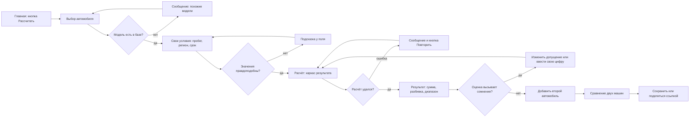

# Бриф ML-продукта

## 1. О проекте

**Название:** «Реальная цена» — сайт для расчёта стоимости владения конкретным автомобилем.

**Описание:** Пользователь выбирает конкретную модель и комплектацию, указывает свои условия (пробег в год, регион, срок владения) и видит, во что ему обойдётся машина за несколько лет: покупка, потеря стоимости при перепродаже, топливо, страховка, налоги, обслуживание и ремонт. Часть расходов не считается по формуле, а оценивается моделью машинного обучения, поэтому результат показывается диапазоном, а не одним «точным» числом.

**Команда:**

| Участник | Роль | За что отвечает |
|---|---|---|
| <имя> | Исследователь и автор брифа | Интервью с пользователями, аудитория, гипотезы |
| <имя> | Дизайнер интерфейса | Сценарий, макеты, прототип |
| <имя> | Отвечает за ML-часть | Выбор модели, данные, оценка качества |
| <имя> | Презентация | Слайды, сборка материалов |

*Если вы работаете один, оставьте одну строку и напишите, что вы закрываете все роли.*

## 2. Задача

1. **Задача.** Человек, который выбирает автомобиль, сравнивает варианты по цене покупки. Реальные расходы на владение скрыты и разбросаны по десятку источников: сайты страховых, налоговые калькуляторы, форумы, объявления. В итоге дешёвая в покупке машина может оказаться дорогой в содержании. Проблема касается тех, кто покупает машину впервые, и тех, кто выбирает между несколькими вариантами (например, бензиновой и гибридной версией).

2. **Решение.** Сайт, на котором за 2–3 минуты можно получить оценку полной стоимости владения конкретной машиной за выбранный срок и сравнить её с другой. Идеальный результат: пользователь видит итоговую сумму в месяц и за весь срок, понимает, из чего она состоит, и видит, насколько оценка неточная.

3. **Полезное действие проекта.** Чтобы покупателю не нужно было самому искать цены на страховку, налог и ремонт по разным сайтам и собирать их в таблицу. Чтобы он не выбирал машину по цене в объявлении и не узнавал о реальных расходах уже после покупки.

4. **Критерий успеха.** Пользователь, который прошёл сценарий, может своими словами объяснить, из чего складывается итоговая сумма, и без подсказок выбрать из двух машин ту, что дешевле в владении. Проверяется в тесте с 5 людьми. Для ML-части второй показатель: насколько оценка модели отличается от реальных данных на отложенной выборке (см. раздел 5).

## 3. Аудитория

Сегменты (гипотезы, их нужно проверить интервью):

- **Первая машина.** 22–28 лет, ограниченный бюджет, нет опыта владения. Знает цену покупки, не знает, сколько уйдёт на страховку и обслуживание.
- **Выбор между вариантами.** 30–45 лет, сравнивает две-три конкретные машины, например бензин против гибрида. Нужна честная разница в расходах за 4–5 лет.
- **Решение о замене.** Владелец думает о продаже текущей машины. Нужно понять, сколько она ещё будет стоить и сколько съест содержание.

Подробный портрет основного сегмента (первая машина) — в файле `audience.md`.

## 4. Job stories

1. Когда я выбираю между двумя машинами примерно одной цены, я хочу увидеть, какая из них дороже через 4 года, чтобы не переплатить за скрытые расходы.
2. Когда я стою в салоне и мне называют цену, я хочу быстро с телефона узнать, сколько эта машина будет стоить в месяц с учётом всех расходов, чтобы решить, брать ли её.
3. Когда я не уверен в какой-то цифре, я хочу изменить допущение (например, годовой пробег) и сразу увидеть, как изменится итог, чтобы понимать, насколько можно доверять оценке.

## 5. ML-часть

| Вопрос | Ответ |
|---|---|
| Какую задачу решает модель? | Регрессия с оценкой неопределённости. Модель предсказывает два параметра, которые нельзя посчитать по формуле: остаточную стоимость машины через N лет и суммарные расходы на обслуживание и ремонт за срок владения. Остальные статьи расходов (налог, топливо, страховка) считаются по правилам и тарифам. |
| Что пользователь даёт на вход? | Марка, модель, год выпуска, тип двигателя и коробки, пробег при покупке, планируемый годовой пробег, регион, срок владения. Часть полей подставляется по умолчанию. |
| Что модель возвращает? | Для каждого из двух параметров: ожидаемое значение и диапазон (нижняя и верхняя граница). |
| Как результат показывается пользователю? | Итоговая сумма за срок и в месяц, разбивка по категориям. Для оценок модели показывается диапазон полосой и пометка «оценка». Для остальных статей показывается обычная цифра. |
| Что будет, если модель ошибётся? Чем это опасно для пользователя? | Если остаточная стоимость окажется завышена или расходы на ремонт занижены, пользователь выберет более дорогую машину, думая, что она выгоднее. Это денежный ущерб, а не вопрос безопасности. Поэтому интерфейс не выдаёт оценку за факт и показывает диапазон. |
| Нужно ли показывать уверенность модели? В каком виде? | Да. Диапазон значений вместо одного числа и словесная метка надёжности («много данных по этой модели» / «мало данных, оценка грубая»). Метка зависит от того, сколько похожих машин было в обучающих данных. |
| Что пользователь может сделать с плохим результатом? | Изменить допущения и пересчитать, ввести свою цену (например, реальную цену страховки) вместо оценки, пожаловаться на неправдоподобную цифру. Все три действия доступны на экране результата. |
| Сколько пользователь готов ждать результат? Что он видит, пока ждёт? | Не больше 3–5 секунд. Пока идёт расчёт, показывается каркас страницы результата с блоками, которые заполняются по мере готовности (сначала считаемые по формуле, потом оценки модели). |
| Откуда возьмётся модель? | Для курса достаточно готового подхода: градиентный бустинг, обученный на открытом наборе объявлений о продаже подержанных автомобилей. Альтернатива: упрощённая модель на нескольких моделях машин. В брифе фиксируется, что данные иллюстративные и для реального продукта нужны данные выбранного рынка. |

## 6. Основной сценарий (user flow)

Главный сценарий: пользователь выбирает одну машину, получает оценку и добавляет вторую для сравнения.

Ветки, которые обязательно показать на схеме:

- **Пока модель работает:** пользователь видит каркас результата, блоки заполняются по мере готовности.
- **Результат плохой или сомнительный:** пользователь меняет допущение, вводит собственное значение или жалуется на цифру.
- **Ошибка:** модели нет в базе (предлагаем похожие), значения неправдоподобны (подсказка у поля), расчёт не удался (повторить).

## 7. Границы MVP

| Входит в MVP | Не входит |
|---|---|
| Расчёт для 3–5 конкретных моделей автомобилей | Полный каталог всех марок и моделей |
| Один регион | Выбор любой страны и региона |
| Оценка остаточной стоимости и ремонта моделью, остальное по тарифам | Точные страховые котировки от компаний |
| Диапазон и метка надёжности | Прогноз цен на топливо и изменений налогов |
| Сравнение двух машин | Сравнение более двух машин, избранное |
| Сохранение результата ссылкой | Личный кабинет, регистрация |
| Адаптивная вёрстка для телефона | Мобильное приложение |

## 8. Конкуренты и референсы

*Ссылки и описания ниже нужно проверить самому перед сдачей: я их не открывал.*

- **Конкуренты.** Существуют калькуляторы стоимости владения на крупных автомобильных порталах, например Edmunds «True Cost to Own» и Kelley Blue Book «5-Year Cost to Own» (edmunds.com, kbb.com). Найдите аналоги для своего региона. Что проверить: сколько данных они просят у пользователя, показывают ли разбивку, показывают ли неопределённость оценки.
- **Преимущество.** Главное: честная неопределённость. Конкуренты обычно выдают одно число, а мы показываем диапазон и метку надёжности и позволяем заменить оценку своей цифрой. Дополнительно: сравнение двух машин на одном экране и работа на телефоне в салоне.
- **Референсы.** Калькуляторы ипотеки и кредита (простой ввод, мгновенный пересчёт при изменении ползунка), сервисы сравнения тарифов (таблица сравнения с выделением различий).

## 9. Бренд

- **В 5 словах:** честный, понятный, спокойный, точный, прямой.
- **Характер.** Говорит как знающий друг, который не продаёт машину и не давит. Объясняет простыми словами, не прячет неопределённость и прямо говорит, где цифра приблизительная.
- **Образы и метафора.** Чек в магазине: из чего складывается итог, строчка за строчкой.
- **Стили, которые нравятся.** <напишите 1–2 сервиса и что в них привлекает: например, спокойная палитра и крупные числа в финансовых приложениях>.

## 10. Гипотезы

1. Если мы покажем итог диапазоном и пометкой надёжности, то пользователи будут больше доверять оценке, чем при одном числе. Проверим так: покажем двум группам по 5 человек два варианта экрана и спросим, насколько они доверяют результату.
2. Если мы заранее подставим разумные значения по умолчанию, то пользователь дойдёт до результата меньше чем за 5 шагов. Проверим так: замерим число шагов и время в тесте на прототипе.
3. Если мы покажем разницу между двумя машинами в виде «через 4 года дороже на X», то пользователь быстрее выберет вариант, чем по таблице с категориями. Проверим так: дадим пользователям задачу выбрать одну из двух машин и засечём время и уверенность.

## 11. Что ещё важно знать

- **Выбор региона.** Налоги, страховка и цены на топливо зависят от страны и региона. Нужно выбрать один регион, где можно проверить числа.
- **Данные иллюстративные.** Все цифры в прототипе приблизительные и не являются финансовой рекомендацией. Это нужно написать на самом сайте.
- **Этика.** Пользователь не должен принять оценку за обещание. Формулировки на сайте: «оценка», «примерно», а не «будет стоить».
