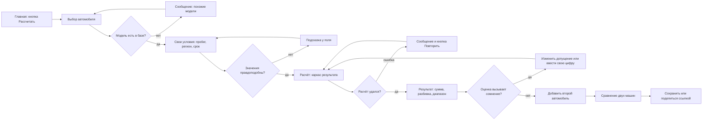

Главный сценарий: пользователь выбирает одну машину, получает оценку и добавляет вторую для сравнения.

Ветки, которые обязательно показать на схеме:

- **Пока модель работает:** пользователь видит каркас результата, блоки заполняются по мере готовности.
- **Результат плохой или сомнительный:** пользователь меняет допущение, вводит собственное значение или жалуется на цифру.
- **Ошибка:** модели нет в базе (предлагаем похожие), значения неправдоподобны (подсказка у поля), расчёт не удался (повторить).